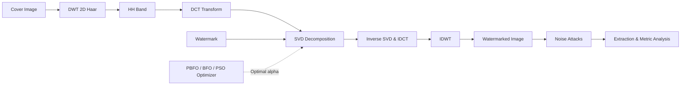

# Digital Watermarking: Hybrid DWT-DCT-SVD with BFO and PSO (PBFO)

[](https://www.mathworks.com/products/matlab.html)
[](LICENSE)
[]()
[](https://github.com/)

A standalone, research-grade MATLAB implementation of a robust, imperceptible digital image watermarking framework. The system combines Discrete Wavelet Transform (DWT), Discrete Cosine Transform (DCT), and Singular Value Decomposition (SVD), with embedding strength parameter optimization using Bacterial Foraging Optimization (BFO), Particle Swarm Optimization (PSO), and a hybrid PSO-BFO (PBFO) algorithm.

---

## Table of Contents

- [Overview](#overview)
- [Key Features](#key-features)
- [System Architecture](#system-architecture)
- [Pipeline Stages & Algorithms](#pipeline-stages--algorithms)
  - [Transform Domains](#transform-domains)
  - [Optimization Algorithms](#optimization-algorithms)
  - [Noise Attacks](#noise-attacks)
  - [Evaluation Metrics](#evaluation-metrics)
- [Project Structure](#project-structure)
- [Prerequisites](#prerequisites)
- [Getting Started](#getting-started)
  - [Running the GUI](#running-the-gui)
  - [Running via Command Line / Script](#running-via-command-line--script)
- [Security & Repository Hygiene](#security--repository-hygiene)
- [Contributing](#contributing)
- [License](#license)

---

## Overview

Digital watermarking protects intellectual property and verifies data integrity by embedding an identification code or logo into multimedia data. The dual challenges of digital watermarking are:
1. **Imperceptibility**: The watermarked image must look indistinguishable from the original cover image (high PSNR and SSIM).
2. **Robustness**: The embedded watermark must withstand image processing degradation and adversarial attacks (high NCC and low BER).

This repository provides an end-to-end framework that benchmarks traditional transforms against metaheuristic optimization techniques to determine the optimal embedding factor ($\alpha$).



---

## Key Features

- **Zero Toolbox Dependencies**: Uses pure MATLAB matrix operations for 2D Haar DWT/IDWT and DCT. No external MATLAB toolboxes required!
- **Multi-Stage Watermarking Schemes**:
  1. **Stage 1 (DWT)**: Direct embedding in high-frequency wavelet subband (HH).
  2. **Stage 2 (DWT + DCT)**: DCT applied to the DWT HH band.
  3. **Stage 3 (DWT + DCT + SVD)**: Singular value decomposition applied to DCT-transformed HH subband.
  4. **Stage 4 (BFO + DWT-DCT-SVD)**: Bacterial Foraging Optimization for tuning embedding factor $\alpha$.
  5. **Stage 5 (PBFO + DWT-DCT-SVD)**: Hybrid PSO-BFO optimization combining swarm exploration with chemotactic foraging.
- **Interactive Multi-Window GUI**: Step-by-step graphical workflow for image selection, attack simulation, extraction, and comparison.
- **Robust Attack Resistance**: Simulates Gaussian noise, Shot (Poisson) noise, Salt & Pepper noise, and Speckle noise.
- **Comprehensive Quality Metrics**: Automatically computes PSNR, SSIM, Image Fidelity (IF), Normalized Cross-Correlation (NCC), and Bit Error Rate (BER).

---

## Project Structure

```text
Digital_Watermarking/
├── .github/                     # GitHub workflows and issue/PR templates
│   ├── ISSUE_TEMPLATE/
│   │   ├── bug_report.md
│   │   └── feature_request.md
│   ├── workflows/
│   │   └── matlab.yml           # CI validation workflow
│   └── pull_request_template.md
├── attacks/                     # Attack simulation modules
│   └── applyNoise.m             # Gaussian, shot, salt & pepper, speckle noise
├── embedding/                   # Watermark embedding algorithms
│   ├── embedDWT.m               # Stage 1: DWT embedding
│   ├── embedDWTDCT.m            # Stage 2: Hybrid DWT-DCT embedding
│   └── embedDWTDCT_SVD.m        # Stage 3: Hybrid DWT-DCT-SVD embedding
├── extraction/                  # Watermark extraction modules
│   └── extractWatermark.m       # Non-blind watermark extraction across all stages
├── gui/                         # Graphical User Interface
│   └── watermarkingApp.m        # 4-stage interactive UI
├── images/                      # Sample datasets
│   ├── cover.jpg                # Sample 512x512 host cover image
│   ├── logo.png                 # Sample 64x64 watermark logo
│   └── README.txt
├── metrics/                     # Quantitative performance evaluators
│   └── calculateMetrics.m       # PSNR, SSIM, IF, NCC, BER
├── optimization/                # Metaheuristic optimization algorithms
│   ├── BFO.m                    # Bacterial Foraging Optimization
│   ├── PSO.m                    # Particle Swarm Optimization
│   └── PBFO.m                   # Hybrid Particle Swarm Bacterial Foraging
├── results/                     # Default output directory for exported images
│   └── README.txt
├── utils/                       # Standalone mathematical utilities & helpers
│   ├── attackAndExtract.m       # Noise attack application & extraction
│   ├── dctMatrix.m              # Standalone orthogonal DCT basis matrix
│   ├── dwt2Haar.m               # Standalone forward 2D Haar DWT
│   ├── idwt2Haar.m              # Standalone inverse 2D Haar DWT
│   ├── embedAllStages.m         # Executes benchmark stages 1 through 5
│   ├── runPipeline.m            # Unified programmatic runner
│   ├── loadImage.m              # Image reading helper
│   ├── prepareCover.m           # Prepares cover image (dimensions, channels)
│   ├── prepareWatermark.m       # Prepares binary watermark matrix
│   ├── resizeNearest.m          # Standalone nearest-neighbor image resizing
│   ├── rgbToGray.m              # Standalone RGB-to-grayscale conversion
│   ├── splitCover.m             # Channel decomposition
│   └── joinCover.m              # Channel recombination
├── .env.example                 # Environment configuration template
├── .gitattributes               # Cross-platform line endings and binary declarations
├── .gitignore                   # Excludes caches, secrets, node_modules, and binaries
├── LICENSE                      # MIT Open Source License
├── main.m                       # Project launcher
└── README.md                    # Project documentation
```

---

## Prerequisites

- **MATLAB**: R2018a or newer.
- **Toolboxes**: **None required**. The code includes custom standalone implementations for wavelet decomposition, DCT transform matrices, resizing, and metric calculations.

---

## Getting Started

### Running the GUI

1. Open MATLAB and navigate to the project directory:
   ```matlab
   cd('path/to/Digital_Watermarking');
   ```
2. Run the main entry point:
   ```matlab
   main
   ```
3. Follow the 4-step interactive workflow:
   - **Step 1: Upload**: Select the cover image (e.g., `images/cover.jpg`) and watermark logo (e.g., `images/logo.png`).
   - **Step 2: Watermark & Attack**: Inspect the watermarked image and its PSNR. Select a noise attack (Gaussian, Shot, Salt & Pepper, Speckle) and variance.
   - **Step 3: Extraction**: Inspect the recovered watermark side-by-side with the original watermark and review the Normalized Correlation (NC).
   - **Step 4: Comparison**: View the comparative performance metrics across all 5 stages (DWT, DWT-DCT, DWT-DCT-SVD, BFO, and PBFO).

### Running via Command Line / Script

You can also run the complete embedding, attack, and extraction pipeline programmatically:

```matlab
% Add project subfolders to path
addpath(genpath(pwd));

% Load cover and watermark
cover = imread('images/cover.jpg');
watermark = imread('images/logo.png');

% Run pipeline with Gaussian noise
res = runPipeline(cover, watermark, 'gaussian');

% Display metrics
disp('--- Extraction Metrics ---');
disp(res.metrics);
```

---

## Algorithms & Metrics

### Noise Attacks Supported

| Attack Type | Description |
| :--- | :--- |
| **Gaussian Noise** | Additive zero-mean Gaussian distributed noise. |
| **Shot / Poisson Noise** | Signal-dependent Poisson noise simulating photon counting variations. |
| **Salt & Pepper Noise** | Impulse noise randomly replacing pixels with minimum or maximum intensities. |
| **Speckle Noise** | Multiplicative noise modifying pixel intensities via $I' = I + n \cdot I$. |

### Evaluation Metrics

- **Peak Signal-to-Noise Ratio (PSNR)**: Measures watermark imperceptibility in decibels ($dB$). Higher is better ($>35\text{ dB}$ represents high quality).
- **Structural Similarity Index (SSIM)**: Evaluates visual structure preservation ($0 \le \text{SSIM} \le 1$).
- **Image Fidelity (IF)**: Assesses fidelity discrepancy between host and watermarked matrices.
- **Normalized Cross-Correlation (NCC)**: Robustness score comparing extracted watermark against original ($0 \le \text{NCC} \le 1$, where $1.0$ is perfect recovery).
- **Bit Error Rate (BER)**: Ratio of corrupted bits to total bits in the watermark.

---

## Security & Repository Hygiene

This repository strictly complies with open-source security standards:
- **No API Keys or Secrets**: All algorithms run entirely offline and locally.
- **Ignored Files**: Configured `.gitignore` prevents inadvertent tracking of `.env` files, credentials, `node_modules/`, system dumps, and generated result images.
- **Preserved Assets**: Clean separation between read-only sample inputs (`images/`) and ignored experiment outputs (`results/`).

---

## Contributing

Contributions, enhancements, and issue reports are welcome! Please check out [CONTRIBUTING](.github/pull_request_template.md) guidelines and use our issue templates for bug reports or feature requests.

1. Fork the Project
2. Create your Feature Branch (`git checkout -b feature/NewAlgorithm`)
3. Commit your Changes (`git commit -m 'Add new watermarking algorithm'`)
4. Push to the Branch (`git push origin feature/NewAlgorithm`)
5. Open a Pull Request

---

## License

Distributed under the MIT License. See [LICENSE](LICENSE) for more details.
